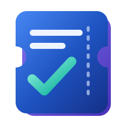
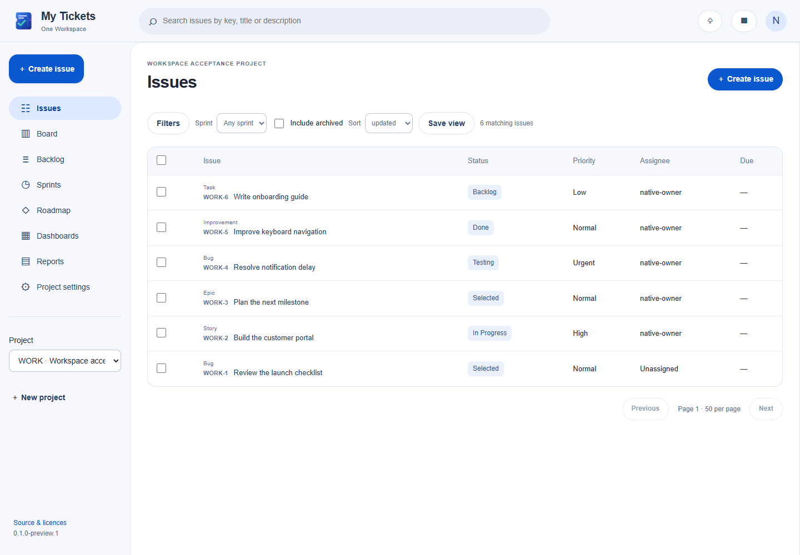

# My Tickets

Plan projects, track issues and see your team's progress in One Workspace.

Create bugs, stories and tasks with permanent issue keys. Organize work on a
board or backlog, run sprints, connect related work through epics, and build
shared dashboards from the issues you can access.

[Dashboard](docs/screenshots/dashboard.png) · [Issue detail](docs/screenshots/issue-detail.png) ·
[Board](docs/screenshots/board.png) · [Phone layout](docs/screenshots/mobile-issues.png)

## Get started

Install or update [One Workspace](https://github.com/oneworkspacestudio/one-workspace).
My Tickets belongs to **General** and is selected by default. Open it from your
Workspace apps menu; your existing MyAccounts session signs you in.

The Windows download also runs independently as **one MyTickets.exe**, with its
interface, API and SQLite database embedded. Run it with a dedicated private data
folder and open the setup link it prints. No Node, Docker or database server is
needed at runtime. [Standalone setup and operations](docs/operations.md).

## Your work, together

- Issues, custom fields, configurable workflows, priorities, assignments and comments.
- Filtered lists, a Kanban board, ordered backlog, sprints, epics and milestones.
- Personal and shared dashboards, real reports, chart data, CSV export and printing.
- Project permissions applied to issues, files, searches, reports and API access.
- Git commit and pull request links, signed webhooks and manual resync.
- Protected attachment storage connected to Drive in managed installations.
- Scoped API credentials and [Codex/MCP access](docs/codex-mcp.md).

This is a preview. See the [acceptance report](docs/ACCEPTANCE.md) for tested
capabilities, live integration checks and remaining limitations.

## Guides

[Architecture](docs/architecture.md) · [MyAccounts](docs/oneaccount-oidc.md) ·
[My Git](docs/mygit-gitea.md) · [Drive and attachments](docs/mydrive-storage.md) ·
[Backups and recovery](docs/backup-restore.md) · [Building](docs/building.md) ·
[API extensions](docs/api-extensions.md) · [Security](SECURITY.md)

## Source and licence

My Tickets is a modified distribution of **Vikunja v2.7.1**, pinned to
`5619c4a9f66ddfc13f7bbba24ada07c3e82ae7a0`. It is licensed under
[GNU AGPL version 3 or later](LICENSE). Upstream attribution and licensing checks
are preserved. [Upstream and modification record](UPSTREAM.md).

The complete corresponding source is available in this repository and alongside
releases. Network users can reach it through **Source & licences** in the app.
Third-party components retain their respective licences; release notices identify
the embedded dependencies and corresponding sources.

### Managed deployment recommendation

Use [One Workspace106 or newer](https://github.com/oneworkspacestudio/one-workspace/releases)
when installing with Drive. Workspace105 is withdrawn because its Drive setup
could precreate the empty Tickets folder before SDK ownership was established.
The corrected manager safely prepares the folder and waits for Tickets readiness.
My Tickets preview1 itself is unchanged. See [acceptance](docs/ACCEPTANCE.md).
